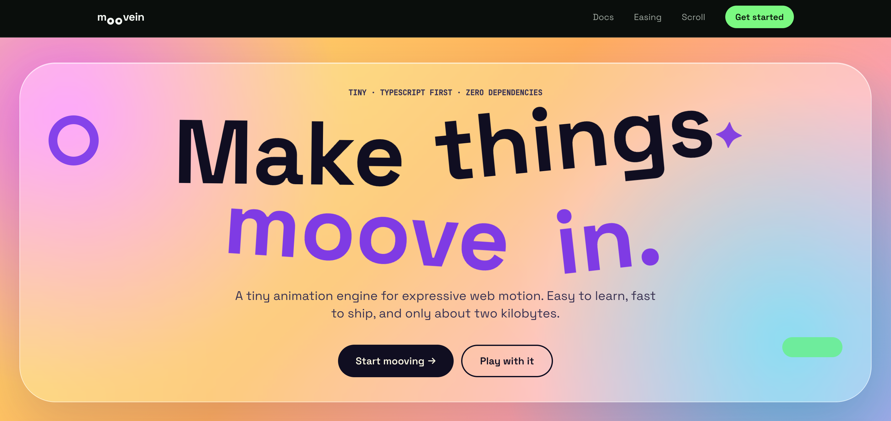

# Moovein

**A tiny, TypeScript-first animation engine for the web.**

Moovein is a lightweight animation library designed to make web animations simple, predictable, and easy to control. It aims to provide a typed API, playback controls, staggered animations, and scroll-triggered effects without adding unnecessary dependencies to your application.

Small by design. Flexible by default.

## Why Moovein?

- **TypeScript-first** — build animations with a developer-friendly, typed API.
- **Lightweight** — keep the core small and avoid unnecessary dependencies.
- **Framework-friendly** — keep the animation engine independent of React, Vue, and Svelte.
- **Controllable playback** — design animations with explicit playback controls.
- **Composable** — support staggered animations and scroll-triggered effects.
- **Open source** — built to be explored, extended, and improved by the community.

## Getting started

Install the core package in your application:

```bash
npm install @tlob/moovein
```

Or use your preferred package manager:

```bash
pnpm add @tlob/moovein
yarn add @tlob/moovein
bun add @tlob/moovein
```

See [`moovein/README.md`](./moovein/README.md) for package-specific documentation and installation details.

## Development

Clone the repository:

```bash
git clone https://github.com/the-last-of-the-bugs/moovein.git
cd moovein
```

Install dependencies:

```bash
pnpm install
```

Run the development scripts configured in the repository's root `package.json`.

> This project uses pnpm in the examples. Adjust the commands if your workspace uses a different package manager.

## Project status

Moovein is under active development. APIs, package boundaries, and features may evolve before the first stable release.

Check the package documentation and release notes for the functionality available in each published version.

## Contributing

Contributions, bug reports, feature ideas, and documentation improvements are welcome.

Before submitting a pull request:

1. Check existing issues and discussions.
2. Keep changes focused and explain the motivation.
3. Run the relevant tests and checks.
4. Update documentation when public APIs or behavior change.

## License

Moovein is intended to be open source. See the repository's `LICENSE` file for the applicable license terms.
