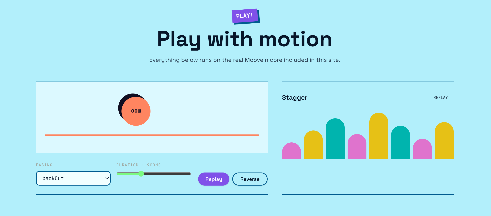

# Moovein


**Tiny TypeScript-first animation engine.**

Moovein is a lightweight, dependency-free animation library for the web. It is designed to provide a typed API, controllable playback, staggered animations, and scroll-triggered effects in a small core.

The goal is simple: make animations easy to create, control, and integrate into modern web applications.

## Installation

Moovein ships as an ES module with TypeScript declarations and no peer dependencies.

```bash
npm install @tlob/moovein
```

Or use another package manager:

```bash
pnpm add @tlob/moovein
```

```bash
yarn add @tlob/moovein
```

```bash
bun add @tlob/moovein
```

### Framework adapters

Framework integrations are distributed separately so the core package doesn't need to pull React, Vue, or Svelte into your bundle.

```bash
# React
pnpm add @tlob/moovein-react

# Vue
pnpm add @tlob/moovein-vue

# Svelte
pnpm add @tlob/moovein-svelte
```

Install the adapter for your framework only when it is available and required by your application.

## Features

- **TypeScript-first API** — type-friendly animation configuration.
- **Lightweight core** — designed to minimize bundle size and dependencies.
- **Playback controls** — manage animation playback explicitly.
- **Stagger** — coordinate animations across multiple elements.
- **Scroll triggers** — start animations in response to scrolling.
- **Framework-independent core** — keep the animation engine separate from UI frameworks.

> Feature availability depends on the published version. Check the release notes before relying on features that are still under development.

## Quick start

The exact API depends on the implementation available in your installed version.

```ts
import { /* exported API */ } from "moovein";

// Create and control an animation using the API
// exported by your installed version.
```

Replace this example with a working animation once the public API has been finalized.

## Documentation

The Moovein documentation and playground will provide:

- Installation and setup guides
- API reference
- Animation examples
- Playback-control examples
- Stagger and scroll-trigger recipes
- Framework adapter guides

## Browser support

Moovein targets modern browsers. Detailed browser and runtime compatibility information will be documented as the supported environments are finalized.

## Bundle size

Moovein is designed to keep its core lightweight. The final compressed bundle size depends on the published build and the functionality included.

## Contributing

Contributions and feedback are welcome. If you find a bug or have an idea for an improvement, open an issue in the repository.

When contributing code:

1. Keep the core independent of UI frameworks.
2. Preserve the TypeScript API's type safety.
3. Add tests for new behavior.
4. Update documentation when the public API changes.

## License

See the repository's `LICENSE` file for the license terms.
